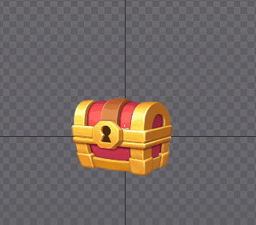
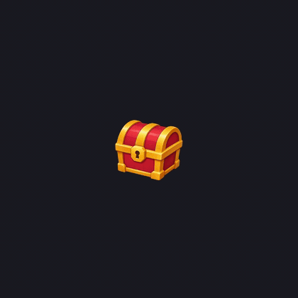
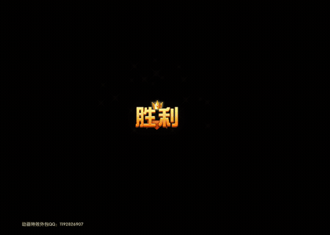
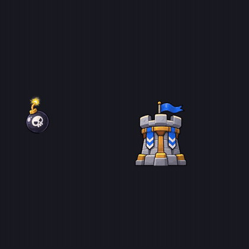

# AE & Figma Motion Replicator

> **给 AI 一张参考 GIF，全自动拆帧分析 → AI 生图并切分透明分件 → 自动写入 Adobe After Effects 合成 & Figma 原生 Motion [Beta] 时间轴关键帧！**

---

## 实测效果对比（原图动画 vs AI 全自动复刻 GIF）

以下 **5 个完整游戏 UI / 特效动画**均由本 Skill 自动拆解、生成/切分透明分件，并在 **Adobe After Effects 2027** 中全自动打帧渲染导出：

### 1.「恭喜通关」破土金奖杯动效
> 自动拆解为「奖杯 + 土堆」2 个静态分件，AE 内自动搭建破土遮罩弹出、弹性回弹、纯 Alpha 爆光白烟、12 枚彩纸屑抛物线、双层描边艺术字扫光与收尾星芒。

| 参考原图 | AI 全自动复刻效果（AE 渲染） |
| :---: | :---: |
|  |  |

### 2.「失败」结算徽章动效
> 自动拆解为「银冠 + 紫盾 + 冰银单翼（镜像复用）」3 个静态分件，AE 内自动完成王冠弹出、盾牌与双翼展开、紫蓝爆光冲击波，以及结尾王冠向左歪斜 `-12°` 的趣味细节。

| 参考原图 | AI 全自动复刻效果（AE 渲染） |
| :---: | :---: |
|  |  |

### 3. 卡通宝箱开启动效（AE + Figma Motion 双端复刻）
> 自动拆解为「底座 + 闭合盖 + 开启盖」3 个透明分件，实现挤压蓄力 → 瞬切开盖过冲 → 径向光晕 & 垂直光束 → 四角星芒扩散。

| 参考原图 | AI 全自动复刻效果（AE 渲染） |
| :---: | :---: |
|  |  |

### 4. 胜利徽章展翼横幅动效
> 自动拆解皇冠、双翼、飘带、盾牌底座等透明分件，AE 内自动完成展翼弹性展开、金色扫光、金币喷发与粒子闪烁。

| 参考原图 | AI 全自动复刻效果（AE 渲染） |
| :---: | :---: |
|  |  |

### 5. 炸弹炸塔动效
> 自动拆解石塔、炸弹、旗帜等 13 个透明分件，AE 内自动完成炸弹抛物线砸塔、爆炸冲击波、烟尘与碎片四溅。

| 参考原图 | AI 全自动复刻效果（AE 渲染） |
| :---: | :---: |
|  |  |

---

## 傻瓜式一键安装（按需三选一，复制发给你的 AI 助手）

无论你使用的是哪种 AI Agent，不用自己敲命令，按你常用的软件**三选一**复制下方提示词发给 AI 即可自动配好：

### 方案 A：仅安装 After Effects 版
```text
请帮我一键安装并配置 https://github.com/amiduai/ae-motion-replicator 的 After Effects 环境：
1. 克隆仓库并安装到你当前 Agent 对应的全局 Skills 目录；
2. 检查并安装 Python 依赖：pip install pillow numpy scipy；
3. 安装 After Effects MCP（https://github.com/Dakkshin/after-effects-mcp）：克隆到 ~/mcp-servers/after-effects-mcp，执行 npm install && npm run build && npm run install-bridge，并写入我的 MCP 配置文件（node ~/mcp-servers/after-effects-mcp/build/index.js）；
4. 检查配置无误后，告诉我最后需要在 AE 里手动打开哪个桥接面板。
```

### 方案 B：仅安装 Figma 原生 Motion [Beta] 版
```text
请帮我一键安装并配置 https://github.com/amiduai/ae-motion-replicator 的 Figma Motion 环境：
1. 克隆仓库并安装到你当前 Agent 对应的全局 Skills 目录；
2. 检查并安装 Python 依赖：pip install pillow numpy scipy；
3. 配置 Figma MCP（https://github.com/LucasGorgal/localfig）：在我的 MCP 配置文件中加入 localfig（command: "npx", args: ["-y", "localfig"]）；
4. 检查配置无误后，告诉我如何在 Figma Desktop 中导入 ~/.localfig/plugin/manifest.json 开启桥接面板。
```

### 方案 C：极简轻量版（HTML + GSAP，免装 AE / Figma）
```text
请帮我一键安装并配置 https://github.com/amiduai/ae-motion-replicator 的轻量 Web 动效环境：
1. 克隆仓库并安装到你当前 Agent 对应的全局 Skills 目录；
2. 安装 Python 依赖：pip install pillow numpy scipy playwright && playwright install chromium；
3. 检查本机是否已安装 ffmpeg（如未安装则提示或通过 brew/apt 安装）；
4. 全部完成后告诉我，以后我发参考 GIF 就可以直接走 HTML + GSAP 方案生成浏览器可预览代码并导出透明 GIF。
```

---

## 手动安装与依赖清单

### 1. 安装 Skill
- **方式 A（直接导入）**：下载 [`dist/ae-motion-replicator.skill`](dist/ae-motion-replicator.skill) 导入到你的 Agent。
- **方式 B（Git 克隆）**：
  ```bash
  git clone https://github.com/amiduai/ae-motion-replicator.git ~/.agents/skills/ae-motion-replicator
  pip install pillow numpy scipy
  ```

### 2. 配置 Adobe After Effects MCP（可选，macOS 亦支持 osascript 直连）
仓库地址：[Dakkshin/after-effects-mcp](https://github.com/Dakkshin/after-effects-mcp)
```bash
git clone https://github.com/Dakkshin/after-effects-mcp.git ~/mcp-servers/after-effects-mcp
cd ~/mcp-servers/after-effects-mcp
npm install && npm run build && npm run install-bridge
```
在 `mcp_config.json` 中添加：
```json
{
  "mcpServers": {
    "after-effects": {
      "command": "node",
      "args": ["/你的用户目录/mcp-servers/after-effects-mcp/build/index.js"]
    }
  }
}
```
> 使用前在 AE 顶部菜单打开 **窗口 → 扩展 / 脚本 → MCP Bridge Auto**。

### 3. 配置 Figma 原生 Motion [Beta] MCP（第三方开源依赖）
依赖开源项目：[LucasGorgal/localfig](https://github.com/LucasGorgal/localfig)（MIT License）。在 `mcp_config.json` 中添加：
```json
{
  "mcpServers": {
    "localfig": {
      "command": "npx",
      "args": ["-y", "localfig"]
    }
  }
}
```
> 首次运行会在 `~/.localfig/plugin/manifest.json` 生成本地桥接插件，在 Figma Desktop 中通过 **Plugins → Development → Import plugin from manifest** 导入并保持开启即可。

---

## 仓库目录结构

```text
ae-motion-replicator/
├── SKILL.md                        # Skill 主指令（GIF 拆解 / 生图 / 切图 / AE & Figma Motion 规范）
├── scripts/
│   ├── split_sprites.py            # GIF 逐帧联系表工具 & 透明合图自动切分去白边脚本
│   └── render_web_gif.py           # 轻量 HTML/GSAP 确定性逐帧导出透明 GIF/MP4 脚本
├── dist/
│   └── ae-motion-replicator.skill  # 打包好的 .skill 安装包，可直接下载导入
├── assets/                         # 5 组原图 vs 复刻 GIF 对比素材
└── README.md
```
